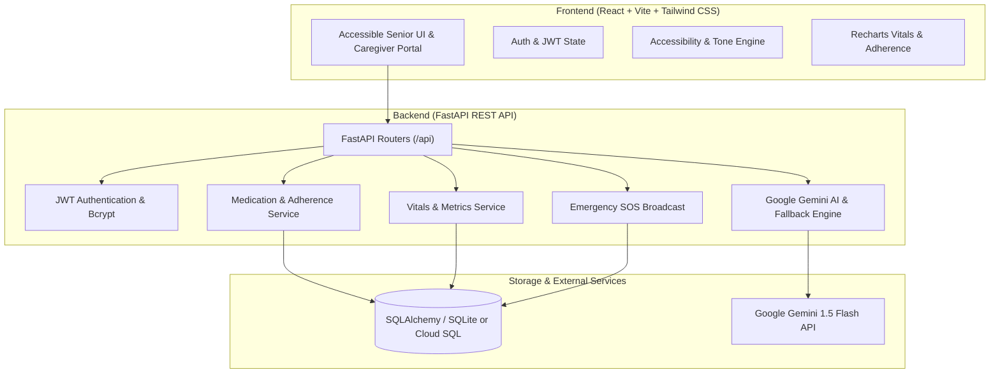

# CareNest AI – Smart Elderly Care & Medication Management Platform
### Developed for the PromptWars × Catalyst Hackathon
**GitHub Repository:** [https://github.com/Nitesh0517/CareNest-AI](https://github.com/Nitesh0517/CareNest-AI)

**CareNest AI** is an intelligent elderly care and medication management platform powered by AI. It helps seniors manage daily medication schedules, track health records, receive smart reminders, and access conversational AI-powered assistance while enabling caregivers to monitor medication adherence and elderly well-being through a unified dashboard.

---

## 1. Project Overview & Problem Statement

### The Problem
1. **Medication Non-Adherence**: Seniors taking multiple prescriptions frequently forget schedules or accidentally double-dose.
2. **Caregiver Anxiety**: Family members and nurses lack real-time visibility into whether daily medicines were actually consumed.
3. **Complex Interfaces**: Modern medical portals are crowded, low-contrast, and overwhelming for elderly users.
4. **Emergency Delays**: In sudden distress or falls, navigating a phone keypad to find emergency contacts is dangerous.
5. **Medical Jargon**: Patients struggle to understand pharmaceutical leaflets (e.g., "take with meals", "avoid sudden standing").

### The Solution: CareNest AI
- **Senior-First Accessibility**: High contrast mode, large font scaling (1.0x, 1.2x, 1.4x), large tap targets, and Web Audio chimes.
- **One-Tap "Mark as Taken"**: Instant timestamped dose logging with duplicate prevention.
- **Dual Role System**: Tailored dashboards for **Elderly Users** and **Caregivers (RN)**.
- **CareNest Assistant (Google Gemini AI)**: Answers wellness questions in plain English, explains medication instructions, and respects strict medical safety guardrails.
- **Rapid Emergency SOS**: One-tap phone dialer (`tel:911` / family) and instant backend broadcast visible on caregiver dashboards.
- **Health Vitals Monitoring**: Log blood pressure, glucose, heart rate, and weight with **Recharts** trend analytics.

---

## 2. System Architecture



---

## 3. Technology Stack

| Layer | Technologies |
|---|---|
| **Frontend** | React 19, Vite, Tailwind CSS v4, React Router DOM v7, Axios, Lucide React, Recharts |
| **Backend** | Python 3.11+, FastAPI, Pydantic v2, SQLAlchemy 2.0, PyJWT, Bcrypt, HTTPX, Uvicorn |
| **AI Integration** | Google Gemini API (Interactions / `gemini-1.5-flash`), Smart Local Fallback Engine |
| **Database** | SQLite (development / demo) with seamless PostgreSQL compatibility (Cloud SQL) |
| **Deployment** | Docker multi-stage builds, Google Cloud Run, Nginx Alpine |

---

## 4. Demo Credentials & Hackathon Quick Access

CareNest AI includes realistic pre-seeded demonstration data and a **one-click demo login system**:

| Role | Demo Email | Password | Details |
|---|---|---|---|
| **Elderly User** | `robert.miller@eldercare.demo` | `Password123!` | 76 yrs old, 5 medications, pre-logged vitals, 88% adherence |
| **Caregiver (RN)** | `sarah.miller@eldercare.demo` | `Password123!` | Registered Nurse & daughter, monitors Robert Miller |

> **Pro Tip**: On the **Sign In** page, click the **"Elderly (Robert)"** or **"Caregiver (Sarah)"** buttons to sign in instantly with one tap!

---

## 5. Core Features Walkthrough

### Feature 1: Role-Based Authentication
- Secure registration and login with role selection (`elderly` or `caregiver`).
- Passwords hashed with **Bcrypt** (salt rounds = 12).
- Signed JWT tokens with Bearer authorization dependencies.

### Feature 2: Elderly Dashboard
- Welcome header with current date and motivational greetings.
- Metric cards: **Total Meds Scheduled Today**, **Completed**, **Upcoming**, and **Missed/Overdue**.
- **Next Reminder Card** with countdown and instructions.
- Daily medication timeline with large, senior-friendly **"Mark as Taken"** buttons.
- Vitals snapshot and prominent **Emergency SOS** card.

### Feature 3: Medication Management & History
- Add, Edit, and Delete prescriptions with dosage, frequency, and start/end dates.
- Multiple scheduled times per day (e.g., `08:00`, `13:00`, `20:00`).
- Category tags (Blood Pressure, Diabetes, Cholesterol, Joint Care, Supplements).
- **Duplicate Prevention**: Prevents duplicate log entries for the same scheduled time.
- **7 to 30 Day Adherence**: Interactive Recharts bar graph comparing taken vs. missed doses.
- Full dose audit log with exact timestamps.

### Feature 4: Caregiver Monitoring Center
- Multi-patient oversight with active adherence percentage.
- Real-time **Active Emergency SOS Alert Banner** with one-tap patient calling and alert resolution.
- Today's upcoming doses across all monitored seniors.
- Live patient activity stream showing recent compliance.
- Ability to connect new elderly members via their email.

### Feature 5: Health Vitals Tracking
- Record **Blood Pressure** (Systolic/Diastolic), **Blood Glucose** (mg/dL), **Heart Rate** (bpm), and **Body Weight** (kg).
- Recharts graphical visualizations for trends over time.
- Clear medical disclaimer: measurements are for wellness tracking and not clinical diagnosis.

### Feature 6: CareNest Assistant (Google Gemini AI)
- Conversational chat companion tailored for seniors.
- Explains complicated medicine instructions in plain language (e.g., why meals prevent nausea).
- Strict safety guardrails: Never prescribes medication, never alters dosage, and directs emergencies to 911 immediately.
- **Graceful Fallback**: If `GEMINI_API_KEY` is not supplied, the built-in CareNest wellness knowledge base handles common inquiries seamlessly.

### Feature 7: Rapid Emergency SOS
- Prominent pulsing red **SOS button** available on all screens.
- Confirmation dialog with 911 one-tap dialing (`tel:911`).
- Trusted emergency contacts list with direct call links.
- Emits emergency events into the backend that instantly alert caregivers.

### Feature 8: Senior-First Accessibility
- **Font Size Scaling**: Toggle between **Normal (1.0x)**, **Large (1.2x)**, and **Extra Large (1.4x)**.
- **High Contrast Mode**: Dark background with bright yellow/white accents for low-vision seniors.
- **Synthesized Audio Tones**: Web Audio API chimes for dose completion and alert pulses for emergencies without external audio dependencies.
- **In-App Browser Reminders**: Native notification permissions to notify users of upcoming doses.

---

## 6. Local Installation & Setup

### Clone Repository
```bash
git clone https://github.com/Nitesh0517/CareNest-AI.git
cd CareNest-AI
```

### Quick Start (Windows)
Double-click `start.bat` or run in PowerShell:
```powershell
./start.ps1
```

### Manual Setup

#### 1. Backend Setup
```bash
cd backend

# Install dependencies
pip install -r requirements.txt

# Configure environment (optional: set GEMINI_API_KEY)
cp .env.example .env

# Run FastAPI server
python -m uvicorn app.main:app --host 127.0.0.1 --port 8000 --reload
```
- API Base URL: `http://127.0.0.1:8000`
- Interactive Swagger Docs: `http://127.0.0.1:8000/docs`

#### 2. Frontend Setup
```bash
cd frontend

# Install dependencies
npm install

# Start Vite development server
npm run dev
```
- Web Application: `http://localhost:5173`

---

## 7. Running the Automated Test Suite

A comprehensive 19-point test suite is included in `backend/test_api_suite.py`:
```bash
cd backend
python test_api_suite.py
```
**Test Coverage Includes:**
- [x] Health check endpoint
- [x] Automatic demo data seeding
- [x] Elderly & Caregiver demo authentication
- [x] Profile JWT verification
- [x] Elderly dashboard metrics & timeline
- [x] Marking medication as taken with timestamp
- [x] Duplicate dose log prevention
- [x] Medication adherence scoring
- [x] Caregiver dashboard multi-patient summary
- [x] Caregiver patient file access
- [x] Health vitals recording & retrieval
- [x] Emergency contacts list
- [x] Emergency SOS triggering
- [x] Caregiver active alert reception & resolution
- [x] Gemini AI assistant chat & offline fallback
- [x] Medication CRUD (Create, Update, Delete)
- [x] New user registration

---

## 8. Google Cloud Run Deployment

Both the frontend and backend include production Dockerfiles optimized for **Google Cloud Run**.

### Step 1: Deploy Backend to Cloud Run
```bash
cd backend

gcloud run deploy carenest-backend \
    --source . \
    --platform managed \
    --region us-central1 \
    --allow-unauthenticated \
    --set-env-vars ENVIRONMENT=production,PORT=8080 \
    --set-secrets GEMINI_API_KEY=gemini-api-key:latest
```
Note the deployed backend URL (e.g., `https://carenest-backend-xyz-uc.a.run.app`).

### Step 2: Deploy Frontend to Cloud Run
```bash
cd frontend

gcloud run deploy carenest-frontend \
    --source . \
    --platform managed \
    --region us-central1 \
    --allow-unauthenticated \
    --set-build-env-vars VITE_API_BASE_URL=https://carenest-backend-xyz-uc.a.run.app/api \
    --port 8080
```

### Storage Note on Cloud Run
Cloud Run containers use ephemeral local storage. For persistent production records, provision a **Google Cloud SQL PostgreSQL** instance and set `DATABASE_URL=postgresql://user:password@/carenest?host=/cloudsql/PROJECT:REGION:INSTANCE`. SQLAlchemy will automatically connect with zero code changes.

---

## 9. API Reference Summary

| Method | Endpoint | Description |
|---|---|---|
| `GET` | `/api/health` | Service health check |
| `POST` | `/api/auth/register` | Register new user (elderly/caregiver) |
| `POST` | `/api/auth/login` | Authenticate and obtain JWT token |
| `POST` | `/api/auth/demo-login/{role}` | Instant 1-click hackathon demo login |
| `GET` | `/api/auth/me` | Fetch authenticated user profile |
| `GET` | `/api/dashboard/elderly` | Elderly home dashboard data |
| `GET` | `/api/dashboard/caregiver` | Caregiver clinical overview data |
| `GET` | `/api/medications` | List user or patient medications |
| `POST` | `/api/medications` | Create medication with schedules |
| `PUT` | `/api/medications/{id}` | Update medication details |
| `DELETE` | `/api/medications/{id}` | Delete medication |
| `GET` | `/api/medication-logs/today` | Today's medication schedule & timeline |
| `POST` | `/api/medication-logs` | Mark medication as taken / record dose |
| `GET` | `/api/medication-logs/adherence` | Adherence score & daily trend history |
| `POST` | `/api/health-records` | Log vitals (BP, glucose, HR, weight) |
| `GET` | `/api/health-records` | Retrieve historical vitals |
| `POST` | `/api/ai/chat` | CareNest Assistant powered by Gemini |
| `POST` | `/api/emergency/sos` | Trigger emergency SOS broadcast |
| `GET` | `/api/emergency/contacts` | List trusted emergency contacts |
| `PUT` | `/api/emergency/events/{id}/resolve`| Resolve active emergency alert |
| `POST` | `/api/demo/reset` | Reset demo data to initial state |

---

## 10. Future Enhancements
- **Voice-Activated Mark as Taken**: Web Speech API for seniors with arthritis or tremor.
- **Computer Vision Pill Identification**: Camera snapshot to verify pill color and shape before taking.
- **SMS / WhatsApp Gateway**: Twilio integration to send SMS alerts to caregivers if high-priority medicines are 60 minutes overdue.
- **Smart Pillbox IoT Integration**: Webhook receiver for smart dispenser hardware (ESP32 / Raspberry Pi).

---

*CareNest AI • Empowering Seniors with Dignity, Reassuring Families with Care.*
